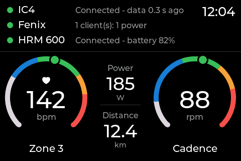

# ESP32 BaseBoard - IC4 Bridge

**IC4 Bridge** turns the ESP32 BaseBoard into a Bluetooth bridge for indoor cycling. A Garmin Fenix 8 no longer
connects to the Schwinn IC4 bike (Garmin bug in FTMS "Trainer" mode). The bridge connects to the bike instead and
sends its data again as a standard **cycling power sensor** that the watch accepts: power, cadence, speed and
distance. It also reads the heart rate of a **Garmin HRM 600** strap.

On its 4" screen, next to the bike:

* at the top, the state of each link (IC4, Fenix, HRM 600) with a coloured dot, and the time of day;
* on the left, the heart rate in a gauge coloured by heart rate zone, with the current zone below;
* in the centre, the power (W) and the distance of the session (km);
* on the right, the cadence in a gauge coloured by cadence zone (green: target cadence).

Touching the screen shows a diagnostic page for the IC4 link.




## BaseBoard

* 2x 18650 LiFePo4 cells that can be charged with the USB connector: more than 5 h of use as an IC4 Bridge
* Low noise +/- 12.4 V going to the mezzanine to power the audio op-amps
* I2S port going to the mezzanine
* MHS 4.0" screen (ST7796S, 480 x 320) with touch (XPT2046)
* Fits inside a Pelican 1040 Micro Case

The IC4 Bridge uses no mezzanine (no audio): the +/- 12.4 V and the I2S port are unused.

The board is easy to order assembled from JLCPCB: the LCSC part numbers are in the schematic, and the production
files (Gerber, BOM, CPL) are in `Hardware/jlcpcb/production_files/` (JLCPCB Tools plugin for KiCad).

Folders: `Hardware/` (KiCad), `Enclosure/` (3D models of the case), `Datasheets/`, `Design/` (pictures of the
README, design notes), `Firmware/`.

## Firmware

ESP-IDF v6.1 project (ESP32-WROOM-32E-N8R2), NimBLE, LVGL 9 for the GUI.

```bash
cd Firmware
idf.py set-target esp32      # only the first time
idf.py build
idf.py -p /dev/ttyUSB0 flash monitor
```

* `main/` : application sources, `main/include/` : headers
* `main/include/Config.h` : pins of the board (screen, touch, I2S, battery), bridge constants, heart rate and
  cadence zones
* `sdkconfig.defaults` : project configuration (PSRAM, flash 8 MB, LVGL and its fonts, NimBLE, watchdog, core dump)
* `main/idf_component.yml` : external components (LVGL), downloaded in `managed_components/`

Serial console (115200 bauds, ANSI terminal such as Tera Term or `idf.py monitor`; opening the port resets the
board): type `help`.

* `bridge` (status of the links, last FTMS frame decoded, data sent), `bridge raw [off]` (every frame),
  `bridge log [clear]` (event log), `bridge unpair` (erase the bonds kept by the bridge)
* `hrm` (strap, battery, heart rate), `hrm forget` (forget the saved strap)
* `wifi list|scan|connect|forget` (networks used for the time of day), `touch cal|test`, `ui perf|benchmark`,
  `restart`

After a crash (event log: "Boot N (PANIC)"), the core dump kept in flash is read with `idf.py coredump-info`.

### Host tests

The FTMS decoder and the crank / wheel data synthesis are plain C, tested on the PC:

```bash
cd Firmware
gcc -std=c11 -Wall -Wextra -Imain/include test/host/test_bridge.c main/Ftms.c main/Crank.c -lm -o /tmp/test_bridge
/tmp/test_bridge
```

## IC4 Bridge

```
 Schwinn IC4 "IC Bike"            ESP32 "IC4 Bridge"                      Fenix 8
 FTMS 0x1826           notify     central: Ic4Client.c     peripheral:    Sensors > Add > Power
 Indoor Bike Data 0x2AD2 ------>  Ftms.c (decoder)         BleServer.c --> Cycling Power 0x1818
                                  Crank.c (crank and       1 Hz           Cycling Speed and Cadence 0x1816
                                  wheel data)                             Device Information 0x180A

 Garmin HRM 600                                                           any client
 Heart Rate 0x180D     notify     central: HrmClient.c     peripheral:
 HR Measurement 0x2A37 ------>    BridgeScreen.cpp         BleServer.c --> Heart Rate 0x180D (each value)
```

### Use

1. The first time, hold the Bluetooth button of the IC4 for 3 s so that the bridge can pair with it. Afterwards,
   the bridge finds the IC4 as soon as the bike wakes up (pedalling), and the HRM 600 as soon as it is worn.
2. On the Fenix, add the bridge **only as a power sensor**: Sensors > Add > Power > IC4 Bridge. Power, cadence,
   speed and distance then come from this one sensor. If the speed is wrong, set the wheel size of the sensor to
   2096 mm (Manual).
3. HRM 600: put it in its **open** connection type once (press its button twice quickly; LED: three green flashes
   every 5 s). The first strap named "HRM 600" / "HRM600" is saved; `hrm forget` to change.
4. IC4 console: do not pair "IC4 Bridge" as its heart rate sensor (see below).
5. Time of day (optional): save a WiFi network in the serial console with `wifi connect <ssid> [password]`. At each
   boot the bridge gets the time over WiFi (SNTP), then turns the WiFi off.

### Fenix side (peripheral)

* Cycling Power Measurement (0x2A63, 1 Hz): flags 0x0030, power (sint16), cumulative wheel revolutions (uint32),
  last wheel event time (uint16, 1/2048 s), cumulative crank revolutions (uint16), last crank event time (uint16,
  1/1024 s). The crank data are synthesised by integrating the FTMS cadence, the wheel data by integrating the FTMS
  speed with a 2096 mm wheel (`WHEEL_CIRCUMFERENCE_MM`); cadence 0 or no FTMS data for more than 3 s: power 0 and
  crank / wheel data frozen.
* The same wheel data are also sent by a speed sensor (Cycling Speed and Cadence 0x1816, CSC Measurement 0x2A5B,
  wheel only). The Fenix does not need it: it takes speed and distance from the power sensor.
* Control points (0x2A66 power, 0x2A55 speed): Set Cumulative Value (wheel revolutions) and, for the power,
  Start Offset Compensation (the "calibration" proposed by the watch, answered with an offset of 0).
* Heart Rate service (0x180D): each value received from the HRM 600 is notified at once (uint8, body location
  chest); no heart rate for 5 s: nothing is sent any more.
* Advertising data: only Cycling Power (0x1818); Heart Rate (0x180D) and CSC (0x1816) are in the scan response.
  With 0x180D in the advertising data, the Fenix classified the bridge as a heart rate strap: it did not appear in
  the "Power" search and, added from "all sensors", it subscribed only to the heart rate.
* One public address for both roles: a random static address for the central role made the ESP32 controller
  advertise with it too, and the Fenix saw an unknown second bridge.
* Up to 3 clients. A repeated pairing that fails (Fenix: DHKey check error) is fixed by removing the sensor on the
  watch and `bridge unpair` on the bridge.

### IC4 and HRM 600 side (central)

* Everything BLE runs in the NimBLE host task (GAP/GATT callbacks and `ble_npl_callout` timers): a reconnection
  never blocks the server.
* The bridge never writes the Fitness Machine Control Point (0x2AD9) and never reads the IC4 heart rate service.
* IC4: reconnection with a backoff of 1 s, 2 s, 4 s... 30 s max; a connection without data for 15 s is closed and
  restarted. Its address is saved in NVS.
* HRM 600: the first strap whose name starts with "HRM 600" or "HRM600" (`HRM_NAME_PREFIXES`) and advertising
  0x180D is used, and its address is saved in NVS: from then on only this strap. The IC4, the bridges and the
  watches broadcasting the heart rate are excluded. In its secure connection type the strap requires an
  authenticated link, impossible without screen or keyboard: the screen then shows "Secure mode: press its button
  2x". Its battery level is read at each connection.
* The IC4 and HRM clients take turns to scan and connect (one scan or connection establishment at a time).
* IC4 console: the bike and its console are one chip with one address, and only one link per peer is possible.
  Over a link opened by the console (to get the bridge heart rate), the IC4 sends no Indoor Bike Data (checked
  2026-11-21: 0 frames in 15 s, although the subscription succeeds). The bridge therefore closes such a link at once
  and connects itself: the IC4 console cannot show the heart rate, which is shown on the bridge screen.
* The IC4 does not send its resistance level over BLE (FTMS features 0x00000000).

### Screen

* Garmin style, refreshed 30 times per second.
* Top: IC4, Fenix and HRM 600 with a dot (green: data, orange: waiting, red: not found) and their state, time of day
  (SNTP over WiFi at boot, then the WiFi driver is released; empty until the time is known).
* Gauges: 270 degree arcs made of 5 coloured bands, each as wide as its span of values, and a marker in the colour
  of the current zone. Zones in `Config.h`, same colours for both gauges (grey, blue, green, orange, red):
  * heart rate: Z1 92, Z2 118, Z3 133, Z4 156, Z5 166-183 bpm (zone shown below the gauge);
  * cadence: Z1 50, Z2 60, Z3 80 (target, green), Z4 95, Z5 105-120 rpm.
* Centre: power (W) and distance of the session (km, integrated from the IC4 speed, back to 0 after 10 min without
  pedalling).
* Touching the screen shows the IC4 details page (last raw frame and its decoding, FTMS characteristics, devices
  seen while scanning, latest events): the diagnostic is possible next to the bike, without the console. Touch again
  to come back.

### Reliability

* Event log kept in flash across restarts: boots (with the reset reason), connections, disconnections, devices
  seen, first FTMS frames of each connection (`bridge log`).
* Task watchdog: the board restarts if the LVGL loop or an idle task stops for 10 s.
* Core dump to the `coredump` partition after a crash.

### Status

* Checked on the bike: Fenix 8 as a power sensor (power, cadence, speed, distance), HRM 600 heart rate on the
  screen.
* Not possible: heart rate on the IC4 console (see above).
* Idea: estimate the resistance level from power and cadence, with a calibration session.
* Unknown: how many simultaneous BLE connections the HRM 600 accepts.

## License

* Firmware (`Firmware/`) and documentation: [GNU GPL v3](LICENSE).
* Hardware (`Hardware/`, KiCad) and enclosure (`Enclosure/`): [CERN-OHL-S v2](Hardware/LICENSE), strongly
  reciprocal: modified designs must stay open under the same licence.
