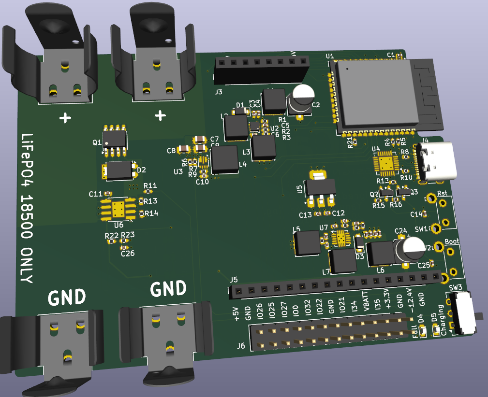

The goals of this BaseBoard:
* Support Bluetooth legacy for receiving audio from an external audio source
* Support 2x 18650 LiFePo4 cell that can be charged with the USB connector
* Low noise +/- 12.4V going to the mezzanine to powered Audio op-amp
* I2S port going to the mezz
* Support of the MHS 4.0 screen (ST7796S) with touch (XPT2046)
* can be placed inside an Pelican 1040 Micro Case



## Firmware

ESP-IDF v6.1 project (ESP32-WROOM-32E-N8R2), LVGL 9 for the GUI.

```bash
cd Firmware
idf.py set-target esp32      # only the first time
idf.py build
idf.py -p /dev/ttyUSB0 flash monitor
```

* `main/` : application sources, `main/include/` : headers
* `main/include/Config.h` : pins of the board (screen, touch, I2S, battery) and bridge constants
* `sdkconfig.defaults` : project configuration (PSRAM, flash 8 MB, LVGL, NimBLE, watchdog)
* `main/idf_component.yml` : external components (LVGL), downloaded in `managed_components/`

Serial console (115200 bauds, ANSI terminal such as Tera Term or `idf.py monitor`): type `help`.

### Host tests

The FTMS decoder and the crank data synthesis are plain C, tested on the PC:

```bash
cd Firmware
gcc -std=c11 -Wall -Wextra -Imain/include test/host/test_bridge.c main/Ftms.c main/Crank.c -lm -o /tmp/test_bridge
/tmp/test_bridge
```

## IC4 Bridge

BLE bridge between a Schwinn IC4 bike, a Garmin HRM 600 heart rate strap and a Garmin Fenix 8 watch.
The Fenix no longer connects to the IC4 (Garmin bug in FTMS "Trainer" mode): the bridge reads the FTMS data of the
IC4 and sends them again as a standard BLE cycling power sensor. It also relays the heart rate of the HRM 600 to the
IC4 console.

```
 Schwinn IC4 "IC Bike"            ESP32 "IC4 Bridge"                      Fenix 8
 FTMS 0x1826           notify     central: Ic4Client.c     peripheral:    Sensors > Add > Power, Speed
 Indoor Bike Data 0x2AD2 ------>  Ftms.c (decoder)         BleServer.c --> Cycling Power 0x1818
                                  Crank.c (crank and       1 Hz           Cycling Speed and Cadence 0x1816
                                  wheel data)                             Device Information 0x180A

 Garmin HRM 600                                                           IC4 console
 Heart Rate 0x180D     notify     central: HrmClient.c     peripheral:    heart rate sensor "IC4 Bridge"
 HR Measurement 0x2A37 ------>                             BleServer.c --> Heart Rate 0x180D (each value)
```

* Everything BLE runs in the NimBLE host task (GAP/GATT callbacks and `ble_npl_callout` timers): a reconnection to
  the IC4 never blocks the server.
* The bridge never writes the Fitness Machine Control Point (0x2AD9) and never reads the IC4 heart rate service
  (0x180D, it relays the heart rate: that would make a loop).
* Cycling Power Measurement (0x2A63, 1 Hz): flags 0x0030, power (sint16), cumulative wheel revolutions (uint32),
  last wheel event time (uint16, 1/2048 s), cumulative crank revolutions (uint16), last crank event time (uint16,
  1/1024 s). The crank data are synthesised by integrating the FTMS cadence, the wheel data by integrating the FTMS
  speed with a 2096 mm wheel (`WHEEL_CIRCUMFERENCE_MM`); cadence 0 or no FTMS data for more than 3 s: power 0 and
  crank / wheel data frozen.
* Speed and distance: the watch computes them from the wheel data. They are also sent by a speed sensor (Cycling
  Speed and Cadence 0x1816, CSC Measurement 0x2A5B, wheel data only). On the Fenix: Sensors > Add > Speed >
  IC4 Bridge, then Wheel Size > Manual > 2096 mm (indoors, the watch cannot calibrate it with the GPS).
* Control points (0x2A66 power, 0x2A55 speed): Set Cumulative Value (wheel revolutions) and, for the power,
  Start Offset Compensation (the "calibration" proposed by the watch, answered with an offset of 0).
* Reconnection to the IC4 with a backoff of 1 s, 2 s, 4 s... 30 s max; a connection without data for 15 s is
  closed and restarted.
* HRM 600: the first strap whose name starts with "HRM 600" or "HRM600" (`HRM_NAME_PREFIXES`) and advertising
  0x180D is used, and its address is saved in NVS: from then on only this strap (`hrm forget` to change). The IC4,
  the bridges and the watches broadcasting the heart rate are excluded. The strap must be in its **open** connection
  type (press its button twice quickly; LED: three green flashes every 5 s). In its secure type it requires an
  authenticated link, impossible without screen or keyboard: the screen then shows "Secure mode: press its button 2x".
  Each value received is notified at once on the bridge Heart Rate Measurement (uint8, body location chest); no
  heart rate for 5 s: nothing is sent any more.
* The IC4 and HRM clients take turns to scan and connect (one scan or connection establishment at a time in
  NimBLE). The bridge has one address (public) for both roles: a random static address for the central role made
  the ESP32 controller advertise with it too, and the Fenix saw an unknown second bridge.
* The IC4 bike and its console are one chip with one address, and NimBLE allows only one link per peer: when the
  console connects to the bridge (heart rate), the bridge reads the FTMS data over that same link. When the IC4
  wakes up, the bridge waits 15 s (`IC4_HR_GRACE_MS`) before connecting itself, so that the console can connect
  first; screen: "Seen - waiting for its console".
* On the Fenix, add the bridge only as a power sensor (Sensors > Add > Power): it also advertises a heart rate
  service (for the IC4 console), and the watch would list it a second time as a heart rate sensor.
  `bridge unpair` erases the bonds kept by the bridge.
* Task watchdog: the board restarts if the LVGL loop or an idle task stops for 10 s.
* Screen (Garmin style): time of day, state of each link (IC4, Fenix, HRM 600) and decoded values, refreshed 30
  times per second: power (W), cadence (green tile in the target 80-95 rpm), distance of the session (km, from the
  IC4 speed, back to 0 after 10 min without pedalling), heart rate with its zone (Z1-Z5, Garmin colours; targets and
  zones in `Config.h`). The IC4 does not send its resistance level over BLE (FTMS features 0x00000000).
* Touching the screen shows the IC4 details page (last raw frame and its decoding, FTMS characteristics, devices
  seen while scanning, latest events): the diagnostic is possible next to the bike, without the console.
* Event log kept in flash across restarts (opening the serial monitor resets the board): connections,
  disconnections, devices seen, first FTMS frames of each connection.
* Console: `bridge` (status of the links, last FTMS frame decoded, power data sent), `bridge raw` (every frame),
  `bridge log [clear]` (event log), `hrm` (strap, battery, heart rate, values relayed), `hrm forget`.

### Phases

1. IC4 -> Cycling Power only. Checked with the Fenix (Sensors -> Add -> Power): power, cadence, speed and distance.
2. Relay of the HRM 600 heart rate to the IC4 console (Heart Rate Service 0x180D on the bridge). Relay checked from a
   PC; with the IC4 console: not checked yet.

### Unknowns

* Does the Fenix accept this BLE power sensor? Yes: power, cadence, and speed / distance from the wheel data.
* Does the IC4 console reconnect by itself to the heart rate sensor, or must its button be held at each session?
* How many simultaneous BLE connections does the HRM 600 accept?
